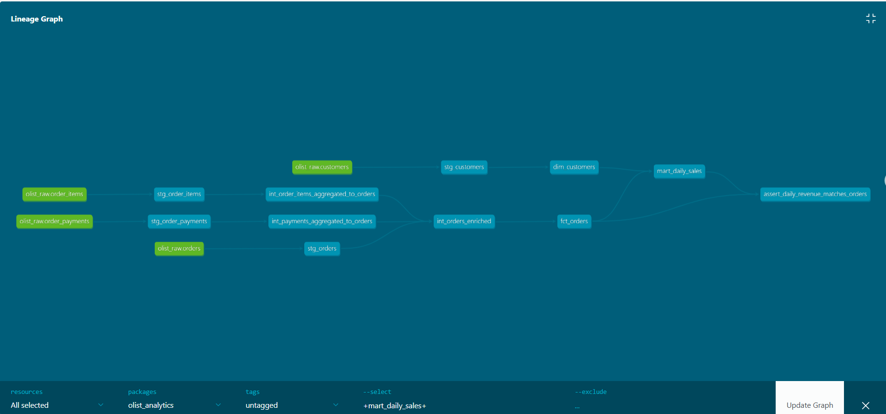

# Olist Data Platform
[](https://github.com/tuanvi0409/olist-data-platform/actions/workflows/ci.yml)

An end-to-end data engineering project that ingests Brazilian e-commerce data into PostgreSQL and transforms it with dbt into analytics-ready fact, dimension, and aggregate tables.

## Architecture

```text
Olist CSV files
    ->
Python ingestion
    ->
PostgreSQL raw schema
    ->
dbt staging views
    ->
dbt intermediate views
    ->
Fact and dimension tables
    ->
Aggregate data marts
```

### dbt Lineage

The lineage graph shows dependencies from raw sources through staging and intermediate transformations to fact, dimension, and aggregate models.

